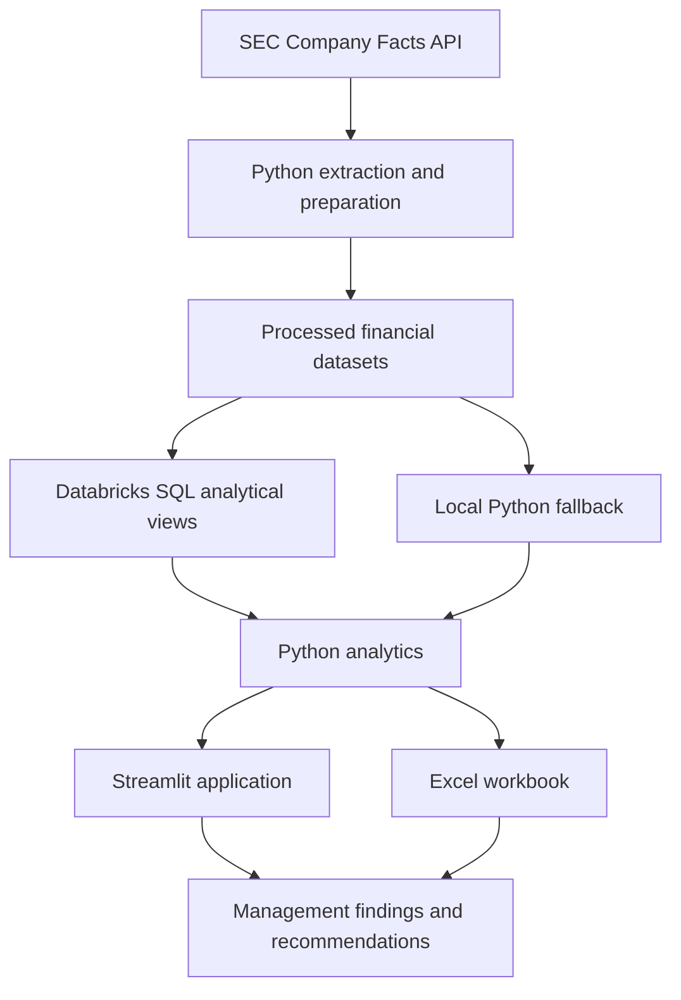
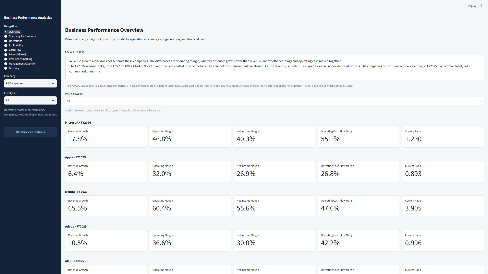
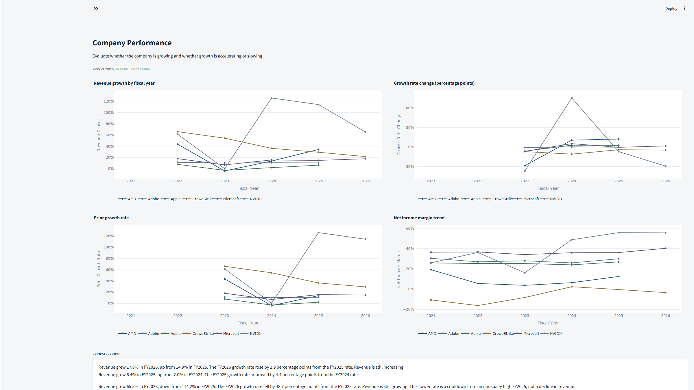
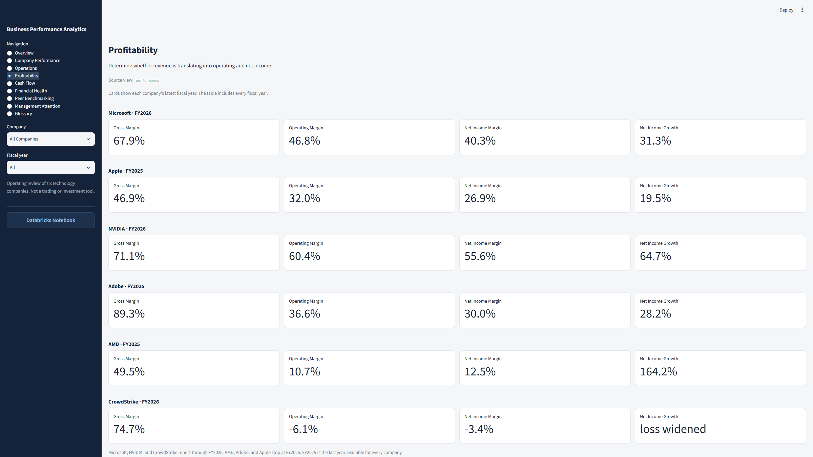
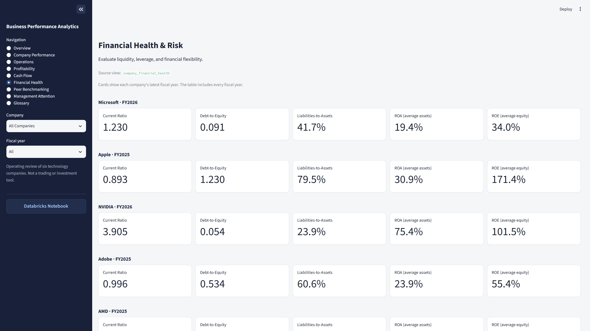
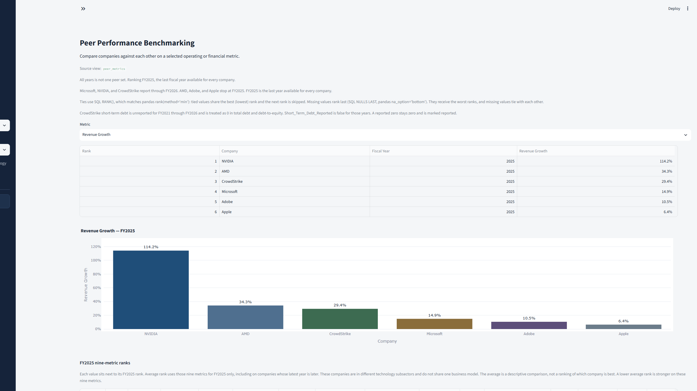
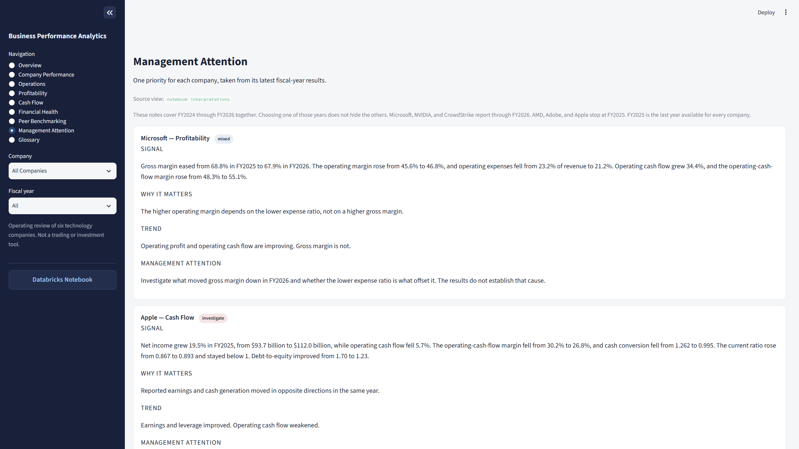
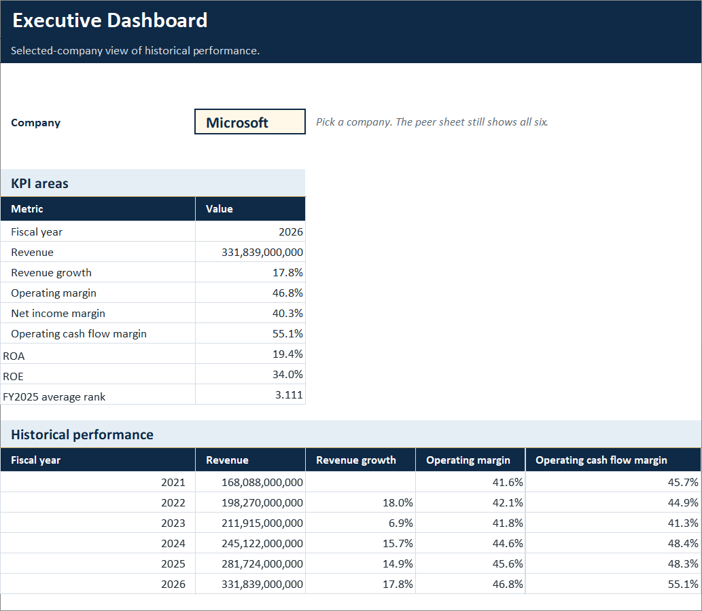
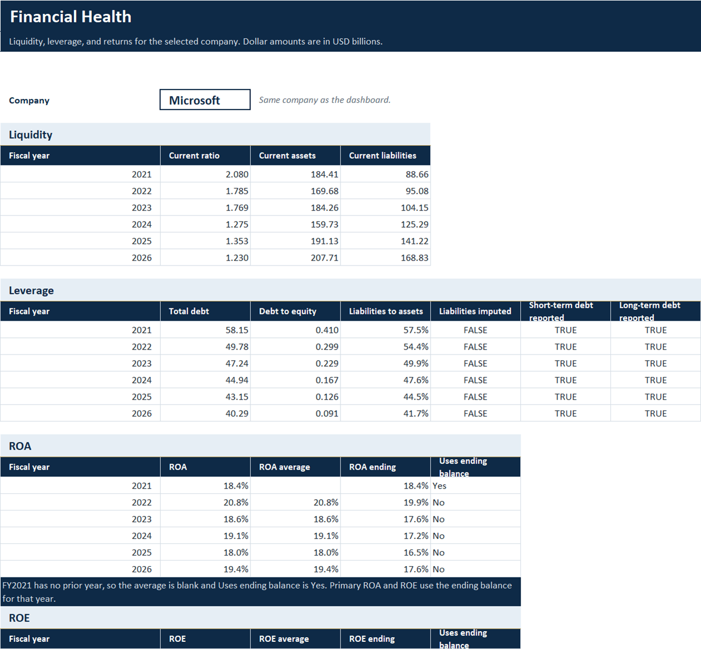
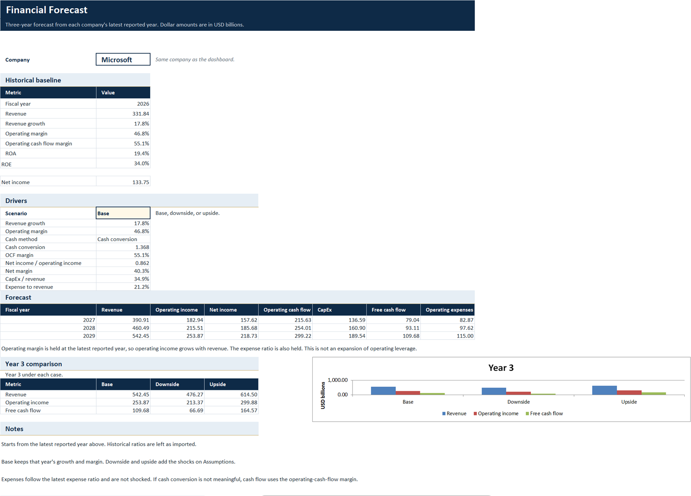

# Business Performance Analytics Platform

Financial performance analysis of six publicly traded technology companies, built from annual SEC filings.

The project compares growth, profitability, operating efficiency, cash generation, and financial health, then records where management attention should go. It is an operating review. It is not a trading tool, a valuation model, or an investment recommendation.

Published app: [Business Performance Analytics](https://business-performance-analytics-platform-bus97yysmxxf9p6kixffdi.streamlit.app/)

## Project overview

Public-company filings contain the same statements every year, but the useful comparison is not a single ratio. Revenue can accelerate while margins ease. Earnings can rise while operating cash flow falls. A company can generate cash and still report an operating loss.

This project turns SEC Company Facts into a repeatable review of those questions for Microsoft, Apple, NVIDIA, Adobe, AMD, and CrowdStrike. A management reader can see how each company's latest year changed, how the six compare on a shared fiscal year, and which result is worth investigating. The written findings stay with the numbers. They do not treat a possible explanation as a proven cause.

## Business questions

- How has each company's financial performance changed over the years in this extract?
- Which companies show stronger revenue growth, profitability, and operating-cash generation?
- Are operating expenses growing faster or slower than revenue?
- What do liquidity and leverage show about financial flexibility?
- How do the companies compare when the comparison is locked to FY2025, the last year available for every company?
- Which trends should management investigate, and which results do not establish a cause?

## Companies and data coverage

The extract contains 33 company-years, from each company's fiscal 2021 through its latest annual filing in the SEC Company Facts data used here.

| Company | Ticker | Fiscal years | Latest year in this extract | Period end, from the revenue fact |
|---|---|---|---|---|
| Microsoft | MSFT | FY2021–FY2026 | FY2026 | June 30 |
| Apple | AAPL | FY2021–FY2025 | FY2025 | Late September |
| NVIDIA | NVDA | FY2021–FY2026 | FY2026 | Late January |
| Adobe | ADBE | FY2021–FY2025 | FY2025 | Late November or early December |
| AMD | AMD | FY2021–FY2025 | FY2025 | Late December |
| CrowdStrike | CRWD | FY2021–FY2026 | FY2026 | January 31 |

Two comparisons are kept separate.

- **Latest fiscal year.** Overview cards, company reads, and management attention use each company's own most recent year. That year is FY2026 for Microsoft, NVIDIA, and CrowdStrike, and FY2025 for Apple, Adobe, and AMD.
- **FY2025 peer benchmark.** Rankings use FY2025 only, because that is the last fiscal-year label present for all six companies. A FY2026 result is not placed in the same rank table as a FY2025 result.

`Fiscal_Year` is the year of the period end. It is not a calendar year, and the six period ends do not fall on the same date.

## Technical architecture



`extract_sec_company_facts.py` calls the SEC Company Facts API, checks the annual facts, and writes the raw extract, the clean long file, and the wide company-year file.

The notebook defines five Databricks SQL views on the warehouse copies of those files. `src/bp_metrics.py` calculates the same views from the local wide file. `src/data_source.py` reads the warehouse when Databricks credentials are set. Otherwise it uses the local files. The Streamlit application uses that loader and does not recalculate the financial formulas itself.

[excel/Business_Performance_Analysis.xlsx](excel/Business_Performance_Analysis.xlsx) is a separate workbook of the same analytical views. It has an executive dashboard, operating performance, cash flow, financial health, peer benchmarking, company analysis, and a three-year forecast from each company's latest reported year. The dashboard headline cash figure is the operating-cash-flow margin. The notebook findings and the Streamlit application do not use that forecast. The workbook stores its query results inside the file. The CSV folder those queries were built from is not in this repository. Do not refresh the queries. A refresh would fail because those source files are not included.

The formulas, null rules, and accepted gaps are in [docs/sql_metrics.md](docs/sql_metrics.md). Short metric notes are in [docs/validation_summary.md](docs/validation_summary.md).

## Data preparation and validation

The extractor requests one Company Facts payload per company from `https://data.sec.gov/api/xbrl/companyfacts/`. It keeps annual Form 10-K and 10-K/A facts from fiscal 2021 onward. Income and cash-flow facts must cover about a year, between 330 and 400 days. Balance-sheet facts are point-in-time. The preferred taxonomy is `us-gaap`.

Duplicate facts collapse to one row per company, fiscal year, and metric. An original 10-K is kept ahead of a 10-K/A, `us-gaap` is preferred, and the latest filed date breaks a remaining tie. The clean file has 1,657 rows. All of them are Form 10-K and `us-gaap`.

Each clean row keeps the company, ticker, CIK, statement, metric, SEC tag, fiscal year, period dates, filed date, form, accession number, unit, value, and source label.

Missing values stay missing. They are not replaced with zero, except for one documented debt rule: total debt treats a missing short-term or long-term leg as zero and sets a reported flag so that treatment is visible. A reported zero stays zero.

The important source gaps in this extract:

- AMD and Microsoft have no `OperatingExpenses` fact for FY2021 and FY2022. Expense ratios and expense growth stay null for those years. FY2023 expense growth is also null, because the prior year is missing.
- AMD has no `Total_Liabilities` fact in any year. Liabilities are assets minus stockholders' equity, and `Total_Liabilities_Imputed` stays true. The accounting identity is not treated as proof that a company reported the amount.
- CrowdStrike does not report short-term debt for FY2021–FY2026. Total debt equals long-term debt, and `Short_Term_Debt_Reported` is false.
- NVIDIA has no capital-expenditure fact for FY2021. Free cash flow is null for that year. It is not filled with zero.

The extractor also checks gross profit and the cash roll-forward within the larger of $1 million or 2%. Assets versus liabilities plus equity can be checked for AMD only after the derived liabilities are applied. After that fill, the identity holds.

## Financial metrics and methodology

Detailed formulas are in [docs/sql_metrics.md](docs/sql_metrics.md). The short definitions below are the ones used in the application.

**Growth.** Revenue growth is the change in revenue divided by prior-year revenue. The growth differential is this year's growth rate minus the prior year's rate. Both rates stay at full precision until the difference is rounded to 3 decimals.

**Profitability.** Gross margin, operating margin, and net income margin are the corresponding profit figures divided by revenue. Net income growth and operating income growth are shown as `n/m` when the prior year is zero or negative. A percent change is not comparable across that sign change.

**Operating efficiency.** Operating-expense growth uses the same year-over-year form as revenue growth. Operating expense / revenue is the expense ratio. Revenue growth minus operating-expense growth uses the unrounded growth rates and rounds only the difference. It is a percentage-point gap, not another margin.

**Cash generation.** The company reads use operating cash flow and the operating-cash-flow margin. Cash conversion is operating cash flow divided by net income. It is shown as `n/m` when net income is zero or negative, or when the absolute ratio is greater than 5. Free cash flow is operating cash flow minus capital expenditures and stays in the calculation layer. It is not a lead finding. Capital expenditures are stored as positive SEC payments.

**Financial health.** The current ratio is current assets divided by current liabilities. Debt-to-equity is total debt divided by stockholders' equity. Liabilities-to-assets uses total liabilities, including AMD's imputed amount. Primary ROA and ROE use the average of the current and prior balance. FY2021 uses the ending balance because there is no prior year, and those rows are flagged. `ROA_Avg` and `ROE_Avg` are blank in FY2021.

**Peer benchmarking.** FY2025 ranks nine metrics with equal weight. Higher is better for revenue growth, operating margin, net income margin, operating-cash-flow margin, current ratio, ROA, and ROE. Lower is better for operating expense / revenue and debt-to-equity. Ties share the best rank. Missing values rank last and tie with each other. `Average_Rank` is the mean of the nine ranks. A lower average is stronger on this set. It is a descriptive comparison. These companies are in different technology subsectors and do not share one business model.

## Management Findings and Business Recommendations

The metrics show what changed. This section says why that change matters and what management should look at next. Each company has a different priority. Revenue growth alone does not explain the difference. The full write-up, including the cross-company comparison and the management attention table, is in [Business Performance Analytics.ipynb](<Business Performance Analytics.ipynb>).

- **Microsoft, FY2026.** Operating margin rose from 45.6% to 46.8% and the operating-cash-flow margin rose from 48.3% to 55.1%, while gross margin eased from 68.8% to 67.9%. Expenses grew 7.4% against revenue growth of 17.8%. Management should find what moved gross margin and whether that expense efficiency can continue.
- **NVIDIA, FY2026.** Revenue still grew 65.5%, down from 114.2%, and the operating margin was 60.4%. Slower growth is not a drop in revenue. Management should judge whether these margins hold as growth becomes less extreme.
- **AMD, FY2025.** Revenue growth accelerated from 13.7% to 34.3%, operating margin rose from 7.4% to 10.7%, and operating cash flow grew 153.5%. The profit level is still comparatively low. Management should see whether growth keeps lifting operating margin before changing costs.
- **Apple, FY2025.** Net income grew 19.5%, from $93.7 billion to $112.0 billion, while operating cash flow fell 5.7% and cash conversion fell from 1.262 to 0.995. Management should review the cash-flow bridge, not treat the earnings increase as a cash increase.
- **Adobe, FY2025.** Operating margin rose from 31.3% to 36.6% because expenses grew 0.9% against revenue growth of 10.5%. The current ratio fell to 0.996 and debt-to-equity rose from 0.399 to 0.534. A current ratio just under 1 is a liquidity signal, not evidence of distress.
- **CrowdStrike, FY2026.** Revenue grew 21.7% and operating cash flow stayed positive, while the operating loss widened from about $116.4 million to $293.3 million. Positive operating cash flow is not operating profit. Management should find which costs grew faster than revenue.

Microsoft, Adobe, and AMD turned revenue growth into a higher operating margin because expenses grew more slowly than sales. NVIDIA's margins cooled from a very strong year and remain high. Apple is the case where earnings and operating cash moved apart. CrowdStrike is the case where cash from operations stayed positive through a wider GAAP operating loss.

Recommendations use the historical financial statements in this project. They are not forecasts, and they do not name a cause the statements do not show. Fiscal years do not cover the same months.

## Application screenshots

The screenshots are from the Streamlit application, using the processed SEC files.













## Workbook screenshots

These are from the Excel workbook, with Microsoft selected and the forecast scenario set to base.







## Technologies

- Python
- SQL
- Databricks SQL
- Streamlit
- Plotly, for the application charts
- pandas
- Excel, in the completed workbook at `excel/Business_Performance_Analysis.xlsx`
- SEC Company Facts API

## Repository structure

```text
extract_sec_company_facts.py          SEC extract, duplicate resolution, wide file, accounting checks
Business Performance Analytics.ipynb  Databricks notebook: preparation, five SQL views, company analysis
app.py                                Streamlit application
src/bp_metrics.py                     Local calculations for the five analytical views
src/data_source.py                    Databricks loader and local fallback
src/interpretations.py                Company findings and management-attention notes
src/glossary.py                       Metric definitions used in the application
src/ui.py                             Tables, charts, and page formatting
src/notebook_view.py                  Renders the notebook inside the application
data/raw/                             Raw SEC extract
data/processed/                       Clean long file and wide company-year file
docs/sql_metrics.md                   View formulas and null rules
docs/validation_summary.md            Short notes on returns, cash conversion, and data gaps
docs/interview_preparation.md         Questions for explaining the project
excel/Business_Performance_Analysis.xlsx   Companion workbook: dashboards plus a three-year forecast
tests/                                Metric, ranking, loader, and notebook checks
```

## Running the project

Tested with Python 3.13.

```bash
git clone https://github.com/treyparkes0/Business-Performance-Analytics-Platform.git
cd Business-Performance-Analytics-Platform
python -m pip install -r requirements.txt
python -m streamlit run app.py
```

The application runs from the processed files when Databricks is not configured. Both of these files need to be present:

- `data/processed/company_financials_wide.csv`
- `data/processed/sec_company_financials_clean.csv`

The wide file is the calculation source. The clean file is how AMD's liability flag is tied to a missing fact rather than to the accounting identity.

To read the warehouse views instead, set these three environment variables. They can live in a local `.env` file, which is gitignored.

- `DATABRICKS_SERVER_HOSTNAME`
- `DATABRICKS_HTTP_PATH`
- `DATABRICKS_TOKEN`

If any of the three is missing or blank, the application builds the views locally and does not connect to Databricks. The local views and the warehouse views use the same formulas. The warehouse path reads views that have already been created in Databricks. Creating or replacing those views is done from `Business Performance Analytics.ipynb`, not from the application.

Refresh the SEC files with:

```bash
python extract_sec_company_facts.py
```

The script sends a User-Agent that includes the contact name and email required by the SEC. Confirm those values in `extract_sec_company_facts.py` before running it.

Run the checks with:

```bash
python -m pytest
```

## Limitations

- The companies do not share a fiscal calendar. FY2025 is a common label, not a common set of months. NVIDIA and CrowdStrike end in January. Microsoft ends in June. Apple ends in September. Adobe and AMD end near the calendar year, on 52/53-week dates.
- SEC tags differ. CrowdStrike revenue uses the tag that includes assessed tax because the excluding-tax tag is not in its facts. NVIDIA's revenue tag is not the same tag in every year. The extractor's tag order records which tag was selected.
- Operating expenses, AMD total liabilities, CrowdStrike short-term debt, and NVIDIA FY2021 capital expenditures are missing in the ways described above. Imputed AMD liabilities are flagged.
- Peer ranks describe this metric set. They do not decide which company is the better business, and the companies operate in different technology subsectors.
- The notebook and the Streamlit findings are historical. The Excel workbook also contains a three-year forecast from the latest reported year, with editable assumptions. That forecast is not part of the notebook findings or the application, and it is not a prediction of results.

## AI-assisted development disclosure

AI-assisted development tools were used to support coding, debugging, and documentation. Project direction, analytical scope, metric selection, data validation, and interpretation were reviewed and guided throughout development.
